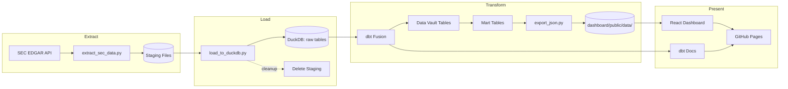

# Design Document: dbt Fusion Financial Analytics POC

## Overview

This POC implements a financial analytics pipeline that extracts SEC filing data, transforms it through Data Vault 2.0 and Star Schema layers using dbt Fusion, and presents it via a static React dashboard. The architecture prioritizes demonstrability, cost efficiency, and extensibility for future enhancements.

The system consists of four main components:
1. **Data Extraction** - Python script fetching SEC EDGAR data
2. **Data Vault Layer** - dbt models implementing DV2.0 methodology
3. **Mart Layer** - dbt models implementing Star Schema for analytics
4. **Dashboard** - React + D3.js static site with dbt docs integration

## Architecture



### Data Flow (ELT Pattern)

**Extract:**
1. User provides ticker symbol → Extraction script queries SEC EDGAR API
2. Raw JSON staged to fastest available location (local or S3)

**Load:**
3. Loader reads staged JSON files into DuckDB raw tables
4. Staging files deleted after successful load

**Transform:**
5. dbt Fusion builds Data Vault models from raw tables
6. dbt Fusion builds Mart layer from Data Vault
7. Export script queries marts, generates JSON to `dashboard/public/data/`

**Present:**
8. Dashboard loads JSON, renders D3.js visualizations
9. GitHub Pages serves dashboard + dbt docs

### Storage Strategy

**Staging (temporary):**
- Default: Local `data/raw/` directory
- Optional: S3 bucket if configured (for faster parallel writes or remote execution)
- Staging files are deleted after successful DuckDB load

**Persistent storage:**
- DuckDB database file (`.duckdb`) containing raw, Data Vault, and Mart tables
- JSON files in React public folder, deployed with the app

## Components and Interfaces

### 1. Extract Component

**Module:** `extraction/extract_sec_data.py`

```python
class SECExtractor:
    def __init__(self, ticker: str, staging_dir: str = "data/raw", s3_bucket: str | None = None)
    def fetch_company_facts(self) -> dict
    def extract_financial_statements(self, facts: dict) -> FinancialData
    def stage_data(self, data: FinancialData) -> list[str]  # writes to local or S3
    def run(self) -> ExtractionResult

@dataclass
class FinancialData:
    ticker: str
    company_name: str
    income_statements: list[StatementPeriod]
    balance_sheets: list[StatementPeriod]
    cash_flows: list[StatementPeriod]

@dataclass
class StatementPeriod:
    fiscal_year: int
    fiscal_quarter: int
    filing_date: date
    line_items: dict[str, float]

@dataclass
class ExtractionResult:
    success: bool
    files_staged: list[str]
    periods_extracted: int
    errors: list[str]
```

**SEC EDGAR API Integration:**
- Endpoint: `https://data.sec.gov/api/xbrl/companyfacts/CIK{cik}.json`
- Rate limit: 10 requests/second (implement exponential backoff)
- CIK lookup: `https://www.sec.gov/cgi-bin/browse-edgar?action=getcompany&CIK={ticker}&type=&dateb=&owner=include&count=1&output=atom`

### 2. Load Component

**Module:** `extraction/load_to_duckdb.py`

```python
class DuckDBLoader:
    def __init__(self, db_path: str = "data/financial.duckdb", staging_dir: str = "data/raw", s3_bucket: str | None = None)
    def load_staged_files(self, file_paths: list[str]) -> LoadResult
    def create_raw_tables(self) -> None
    def cleanup_staging(self, paths: list[str]) -> None
    def run(self, staged_files: list[str]) -> LoadResult

@dataclass
class LoadResult:
    success: bool
    rows_loaded: int
    tables_created: list[str]
    staging_cleaned: bool
    errors: list[str]
```

**Raw Tables Created:**
- `raw_income_statement` - Income statement line items by period
- `raw_balance_sheet` - Balance sheet line items by period  
- `raw_cash_flow` - Cash flow line items by period
- `raw_company_info` - Company metadata (ticker, name, CIK)

### 3. Data Vault Layer (dbt Models)

**Hubs:**

| Model | Business Key | Columns |
|-------|-------------|---------|
| hub_company | ticker | hash_key, ticker, load_datetime, record_source |
| hub_financial_period | fiscal_year + fiscal_quarter | hash_key, fiscal_year, fiscal_quarter, load_datetime, record_source |
| hub_account | account_id | hash_key, account_id, load_datetime, record_source |

**Links:**

| Model | Related Hubs | Columns |
|-------|-------------|---------|
| link_company_period | hub_company, hub_financial_period | hash_key, company_hash_key, period_hash_key, load_datetime, record_source |
| link_period_account | hub_financial_period, hub_account | hash_key, period_hash_key, account_hash_key, load_datetime, record_source |

**Satellites:**

| Model | Parent | Columns |
|-------|--------|---------|
| sat_company_details | hub_company | hash_key, company_name, sector, industry, hash_diff, load_datetime, record_source |
| sat_financial_statement | link_period_account | hash_key, value, statement_type, hash_diff, load_datetime, record_source |
| sat_period_attributes | hub_financial_period | hash_key, filing_date, fiscal_year_end, hash_diff, load_datetime, record_source |

### 4. Mart Layer (dbt Models)

**Dimensions:**

| Model | Grain | Key Columns |
|-------|-------|-------------|
| dim_company | company | company_key, ticker, company_name, sector, industry |
| dim_period | fiscal period | period_key, fiscal_year, fiscal_quarter, calendar_date, period_label |
| dim_account | account | account_key, account_id, account_name, statement_type, category |

**Facts:**

| Model | Grain | Measures |
|-------|-------|----------|
| fact_financial_statement | company + period + account | value |
| fact_financial_metrics | company + period | revenue, revenue_growth_yoy, revenue_growth_qoq, gross_margin, operating_margin, net_margin, debt_to_equity, roa, fcf, fcf_to_assets |

### 5. JSON Export Component

**Module:** `extraction/export_json.py`

```python
class JSONExporter:
    def __init__(self, db_path: str, output_dir: str = "dashboard/public/data")
    def export_income_statement(self) -> str
    def export_balance_sheet(self) -> str
    def export_cash_flow(self) -> str
    def export_financial_metrics(self) -> str
    def run(self) -> ExportResult

@dataclass
class ExportResult:
    files_created: list[str]
    total_size_bytes: int
    export_timestamp: datetime
```

**JSON Schema (example for income_statement.json):**
```json
{
  "metadata": {
    "ticker": "AAPL",
    "export_timestamp": "2025-12-23T10:00:00Z",
    "periods_included": 40
  },
  "data": [
    {
      "fiscal_year": 2024,
      "fiscal_quarter": 4,
      "period_label": "Q4 2024",
      "revenue": 123456789,
      "cost_of_revenue": 67890123,
      "operating_expenses": 12345678,
      "net_income": 43210987
    }
  ]
}
```

### 6. Dashboard Component

**Structure:**
```
dashboard/
├── src/
│   ├── App.tsx
│   ├── components/
│   │   ├── Header.tsx
│   │   ├── Footer.tsx
│   │   ├── Navigation.tsx
│   │   ├── ScoreCard.tsx
│   │   └── charts/
│   │       ├── StackedBarChart.tsx
│   │       ├── SankeyDiagram.tsx
│   │       ├── LineOverlay.tsx
│   │       └── DataTable.tsx
│   ├── pages/
│   │   ├── IncomeStatement.tsx
│   │   ├── BalanceSheet.tsx
│   │   └── CashFlow.tsx
│   ├── hooks/
│   │   └── useFinancialData.ts
│   └── types/
│       └── financial.ts
├── public/
│   ├── data/
│   │   ├── income_statement.json
│   │   ├── balance_sheet.json
│   │   ├── cash_flow.json
│   │   └── financial_metrics.json
│   └── images/
└── package.json
```

**Key Interfaces:**
```typescript
interface FinancialPeriod {
  fiscal_year: number;
  fiscal_quarter: number;
  period_label: string;
}

interface IncomeStatementData extends FinancialPeriod {
  revenue: number;
  cost_of_revenue: number;
  operating_expenses: number;
  net_income: number;
}

interface BalanceSheetData extends FinancialPeriod {
  total_assets: number;
  total_liabilities: number;
  total_equity: number;
}

interface CashFlowData extends FinancialPeriod {
  operating_cash_flow: number;
  capex: number;
  asset_sale_proceeds: number;
}

interface FinancialMetrics extends FinancialPeriod {
  revenue_growth_yoy: number;
  revenue_growth_qoq: number;
  gross_margin: number;
  operating_margin: number;
  net_margin: number;
  debt_to_equity: number;
  roa: number;
  fcf: number;
  fcf_to_assets: number;
}
```

## Data Models

### SEC EDGAR Data Structure

The SEC EDGAR API returns company facts in XBRL format:
```json
{
  "cik": 320193,
  "entityName": "Apple Inc.",
  "facts": {
    "us-gaap": {
      "Revenues": {
        "units": {
          "USD": [
            {
              "end": "2024-09-28",
              "val": 391035000000,
              "accn": "0000320193-24-000123",
              "fy": 2024,
              "fp": "FY",
              "form": "10-K",
              "filed": "2024-11-01"
            }
          ]
        }
      }
    }
  }
}
```

### Key Account Mappings

| SEC XBRL Tag | Display Name | Statement |
|--------------|--------------|-----------|
| Revenues / RevenueFromContractWithCustomerExcludingAssessedTax | Revenue | Income |
| CostOfGoodsAndServicesSold / CostOfRevenue | Cost of Revenue | Income |
| OperatingExpenses | Operating Expenses | Income |
| NetIncomeLoss | Net Income | Income |
| Assets | Total Assets | Balance |
| Liabilities | Total Liabilities | Balance |
| StockholdersEquity | Total Equity | Balance |
| NetCashProvidedByUsedInOperatingActivities | Operating Cash Flow | Cash Flow |
| PaymentsToAcquirePropertyPlantAndEquipment | CapEx | Cash Flow |
| ProceedsFromSaleOfPropertyPlantAndEquipment | Asset Sale Proceeds | Cash Flow |

## Correctness Properties

*A property is a characteristic or behavior that should hold true across all valid executions of a system-essentially, a formal statement about what the system should do. Properties serve as the bridge between human-readable specifications and machine-verifiable correctness guarantees.*

### Property 1: Staging Path Format Consistency
*For any* valid ticker symbol and filing date, the generated staging path SHALL match the pattern `ticker={TICKER}/filing_date={YYYY-MM-DD}/` where TICKER is uppercase and date is ISO format.
**Validates: Requirements 1.3**

### Property 2: Financial Statement Completeness
*For any* extracted filing data, the output SHALL contain at least one record for each of the three statement types: income_statement, balance_sheet, and cash_flow.
**Validates: Requirements 1.2**

### Property 3: Data Vault Model Structure
*For any* Data Vault Hub or Link model output, the record SHALL contain columns: hash_key, load_datetime, and record_source. *For any* Satellite model output, the record SHALL additionally contain hash_diff.
**Validates: Requirements 2.9, 2.10**

### Property 4: Financial Metric Calculation Correctness
*For any* valid financial data with revenue values R1 (current) and R0 (prior year), the calculated revenue_growth_yoy SHALL equal (R1 - R0) / |R0| when R0 ≠ 0, and NULL when R0 = 0.
**Validates: Requirements 3.6**

### Property 5: Margin Calculation Bounds
*For any* calculated margin metric (gross_margin, operating_margin, net_margin), the value SHALL be between -1000% and 100% (allowing for losses but capping extreme outliers).
**Validates: Requirements 3.6**

### Property 6: JSON Export Size Constraint
*For any* exported JSON file, the file size SHALL be less than 1,048,576 bytes (1MB).
**Validates: Requirements 4.2**

### Property 7: JSON Metadata Presence
*For any* exported JSON file, the root object SHALL contain a "metadata" object with non-null "export_timestamp" and "ticker" fields.
**Validates: Requirements 4.3**

### Property 8: Hash Key Uniqueness
*For any* Hub table, the hash_key column SHALL contain no duplicate values.
**Validates: Requirements 10.1**

## Error Handling

### Extract Errors

| Error Type | Handling Strategy |
|------------|-------------------|
| SEC API rate limit (429) | Exponential backoff: 1s, 2s, 4s, then fail |
| SEC API unavailable (5xx) | Retry 3 times with 5s delay, then fail |
| Invalid ticker (404) | Log error, return empty result |
| Missing XBRL fields | Log warning, continue with available data |
| Staging write failure | Try alternate location (S3↔local), then fail |

### Load Errors

| Error Type | Handling Strategy |
|------------|-------------------|
| Staged file not found | Log error, skip file, continue with others |
| JSON parse error | Log error with file path, skip file |
| DuckDB connection failure | Retry once, then fail |
| Schema mismatch | Log warning, attempt type coercion |
| Staging cleanup failure | Log warning, continue (non-fatal) |

### Transform Errors

| Error Type | Handling Strategy |
|------------|-------------------|
| dbt model failure | Halt pipeline, report failing model |
| dbt test failure | Halt pipeline, report test name and row count |
| Missing source data | Skip model, log warning |
| Type conversion error | Cast to NULL, log warning |

### Dashboard Errors

| Error Type | Handling Strategy |
|------------|-------------------|
| JSON fetch failure | Display error message with retry button |
| Invalid JSON format | Display "Data unavailable" message |
| Missing required fields | Render partial data, hide affected charts |

## Testing Strategy

### Unit Testing

Unit tests verify specific examples and edge cases:

- **Extraction:** Test SEC API response parsing, S3 path generation, error handling
- **dbt Models:** Use dbt's built-in testing for schema validation
- **Export:** Test JSON serialization, file size calculation
- **Dashboard:** Test component rendering, data transformation hooks

### Property-Based Testing

Property tests verify universal properties across all inputs. We will use:
- **Python:** `hypothesis` library for extraction and export components
- **TypeScript:** `fast-check` library for dashboard data transformations

Each property test will:
- Run minimum 100 iterations
- Be tagged with format: `**Feature: init, Property {N}: {description}**`
- Reference the correctness property from this design document

### Integration Testing

- End-to-end pipeline test with sample ticker (AAPL)
- dbt model dependency validation
- Dashboard data loading verification

### dbt Tests

```yaml
# schema.yml for Data Vault models
models:
  - name: hub_company
    columns:
      - name: hash_key
        tests:
          - unique
          - not_null
      - name: ticker
        tests:
          - unique
          - not_null

  - name: sat_financial_statement
    columns:
      - name: hash_key
        tests:
          - not_null
      - name: value
        tests:
          - not_null
```
